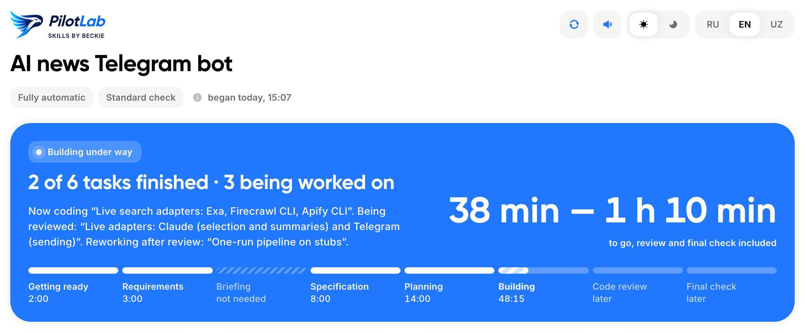
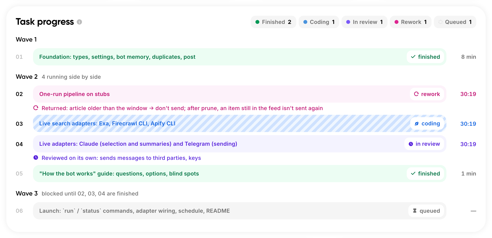
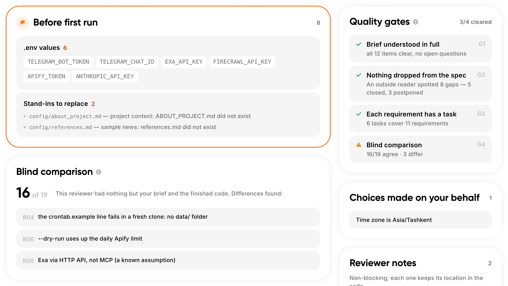
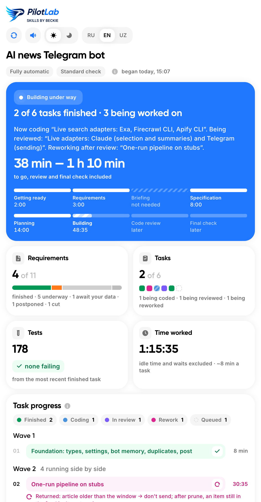
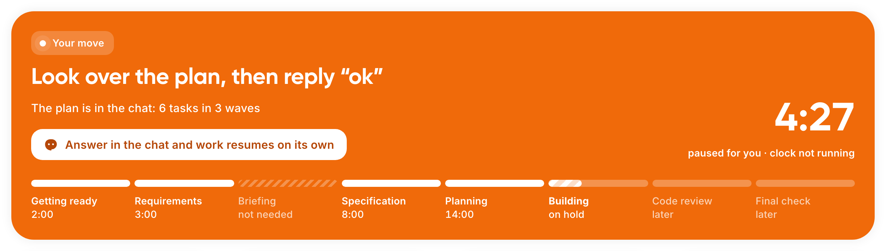
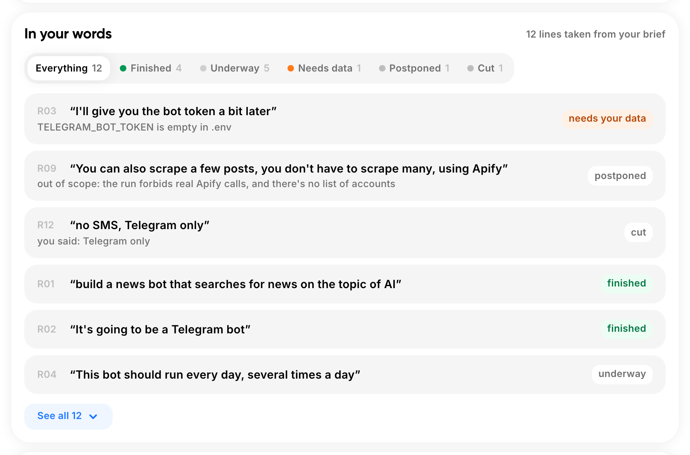

<p align="center">
  <picture>
    <source media="(prefers-color-scheme: dark)" srcset="assets/pilot-lab-logo-dark.png">
    
  </picture>
</p>

<p align="center">
  <a href="https://skills.sh/hiBehruz/PilotLab"></a>
</p>

<p align="center"><b>Say what you want. Get back a finished project.</b></p>

<p align="center">English · <a href="README.ru.md">Русский</a></p>

One agent skill holds the whole of **Pilot by Beckie**, a development framework: an idea goes in, a built project comes out. Questions appear only at points where your idea could turn into genuinely different products. After that it drafts the spec itself, fills in what you left unsaid, breaks the job into tasks and builds them. Reading the spec, sizing tasks and reviewing code are never your job. No other installation is required.

<p align="center">
  <a href="assets/pilot-dashboard.png"></a>
  <a href="assets/pilot-dashboard.png"></a>
  <a href="assets/pilot-dashboard.png"></a>
</p>
<p align="center"><sub><a href="assets/pilot-dashboard.png">Full-size screenshot of the dashboard</a></sub></p>

While it builds, you watch a live dashboard. The agent opens it on its own when the build starts. The whole thing is a single HTML file. One look at the header color is enough (blue means work in progress, orange means it needs you, green means finished); the timers run live, the page updates by itself and works without internet.

---

## Contents

- [Install](#install)
- [Using it](#using-it)
- [Modes and depth](#modes-and-depth)
- [Why results match what you asked for](#why-results-match-what-you-asked-for)
- [The dashboard](#the-dashboard)
- [Project memory](#project-memory)
- [How a build runs](#how-a-build-runs)
- [Is it the right tool?](#is-it-the-right-tool)
- [Keys and secrets](#keys-and-secrets)
- [What it never does](#what-it-never-does)
- [Updating and removing](#updating-and-removing)
- [FAQ](#faq)
- [What is in this repository](#what-is-in-this-repository)
- [License](#license)

---

## Install

### Without a terminal

Paste this into your AI agent (Claude Code, Cursor, Codex):

```text
Please add the Pilot by Beckie skill using this command:
npx skills add hiBehruz/PilotLab --skill pilot-beckie -g -y -a <your agent: claude-code, cursor or codex>
If npx is not available, give me the Node.js download link (https://nodejs.org) and stop.
Do not install anything else. When it is done, reply with one line: "Ready, restart the session."
```

Restart the session afterwards: agents load skills only at startup. This prompt is for the first install; to get a newer version, see [Updating and removing](#updating-and-removing).

### From a terminal

```bash
npx skills add hiBehruz/PilotLab
```

You will be prompted to pick the skills and the target agents, and then to confirm.

<details>
<summary>Non-interactive install</summary>

```bash
npx skills add hiBehruz/PilotLab --skill pilot-beckie -a claude-code -g -y
```

| Option | Effect |
|---|---|
| `--skill pilot-beckie` | install only this skill |
| `-a claude-code` | the agent to install for |
| `-g` | global: available in every project |
| `-y` | no confirmation prompts |

Drop `-g` to install into the current project only.

</details>

### Requirements

- **Node.js**, for `npx`.
- **Python 3**. The skill keeps its run bookkeeping and the dashboard with a small Python script. Without Python the build still runs from start to finish, just without the dashboard.
- **A supported agent**: Claude Code, Cursor, Codex, or any of the 70+ others on the [supported agents list](https://github.com/vercel-labs/skills#supported-agents).

---

## Using it

Open your agent in the folder where the project should live and type:

```text
/pilot-beckie a Telegram bot that takes haircut bookings for my barbershop
```

Nothing but this command launches Pilot. Even a message like "just build it" will not trigger it, since a run creates a git repository, writes code and makes commits.

### Big ideas: hand it a file

When the description is long, write it down in any file, in any form (`brief.md`, `idea.txt`, whatever you like), and pass the path:

```text
/pilot-beckie brief.md
/pilot-beckie deep brief.md and keep everything on SQLite
```

Words after the path are added to the task. Your file is left as it is; Pilot stores its own copy in `.pilot-beckie/`, and the final check compares the result against that copy.

### The first reply

Before anything else, Pilot tells you how it is set up for this build. An example of what that looks like:

```text
Mode: semi-automatic. Depth: normal. I'll ask only about what your
description leaves open, then build on my own.
Dashboard: http://localhost:8765/dashboard.html (opening it now, it updates itself)
Project memory: AGENTS.md (a one-line CLAUDE.md refers to it).

You can change this at any time, just say:
  "fully automatic"  - no questions at all
  "interview me"     - questions to the end, then I build alone
  "approve every step" - as above, and you sign off spec and tasks
  "strictly as written" / "go deep" - a narrower or wider reading of your words
```

### Questions

Questions come in numbered rounds. Every question already carries the answer Pilot would pick. Reply `ok` to accept all of them, or change only some by number (`2: no, cards only`).

---

## Modes and depth

Two independent dials. **Mode** decides how much you are asked. **Depth** decides how much is worked out for you.

### Modes

| Mode | Trigger | Questions you get |
|---|---|---|
| Fully automatic | `full`, "fully automatic" | Nothing. At the end you get the list of decisions taken on your behalf. |
| Semi-automatic (default) | say nothing | Just the open points of the task: typically a round or two, occasionally zero. |
| Interview | `interview`, "interview me", "grill me", "ask me everything" | All forks in the idea, and also the spots where it could fail. After that the build runs without you. |
| Manual | `manual`, "approve every step" | All of Interview, and you also approve the spec and the task list. |

```text
/pilot-beckie full landing page for my bakery
/pilot-beckie interview an app for tracking my team's vacation days
/pilot-beckie manual deep brief.md
```

Keywords are written without dashes. You can switch modes in the middle of a build; the new mode applies from the next stage.

Two things hold in every mode, `full` included:

- Pilot pauses for your answer ahead of any irreversible step: payments, publishing, deleting data, writing to people.
- The final check against your original description cannot be turned off.

### Depth

| Depth | Trigger | Effect |
|---|---|---|
| Strict | `strict`, "strictly as written" | Only what you wrote. Errors and empty states are still handled. |
| Normal (default) | say nothing | Closes gaps that would clearly spoil the result. Every addition is tied to one of your requirements. |
| Maximum | `deep`, "go deep", "think it through" | Each requirement is run against a complete list: the first launch, an empty screen, invalid input, failures, a dropped connection, growth, access rights, side effects. |

Mode and depth words can come in any order, both are optional, and depth can also change mid-run. Russian phrases work too, for example «делай всё сам», «устрой мне интервью», «ручной режим», «строго по задаче», «продумай глубже»; the full lists are in [phases/0-modes.md](skills/pilot-beckie/phases/0-modes.md).

Whatever the depth, each addition from Pilot hangs off one of your requirements and gets its own section in the final report. If a feature has no link to something you asked for, it is removed.

### References

In the briefing you may point to sites, apps or texts you want the result to look like. Pilot records them in `reference.md`, and every agent working on UI receives that file. Only you supply references; Pilot does not choose any on your behalf.

---

## Why results match what you asked for

**Nothing gets lost.** Your description is split into numbered requirements quoted word for word, and each one carries a status. Checks run at fixed points:

- after the spec: every requirement has a section;
- after planning: every requirement belongs to a task, and every task serves a requirement;
- blind acceptance closes the build: one more agent, never shown the spec, compares the finished project with your original description and nothing else.

Only you can drop a requirement. Silence does not count as cancelling it.

**It thinks through what you did not.** A description usually covers the happy path. Pilot fills in empty screens, dropped connections, double submits, the very first launch. How far it goes is set by depth. Small decisions it takes itself; real decisions become questions for you.

---

## The dashboard



As soon as a build begins, `.pilot-beckie/dashboard.html` appears by itself, inside the agent's side pane if the app has one (Claude's app does) or else as a browser tab. Narrow widths switch it to a compact layout. No network is needed.

Every 10 seconds it picks up fresh data without reloading, so your scroll position and selection stay put. The refresh arrow updates it right now. There are switches for theme (light or dark; follows your system until you pick one) and language (RU / EN / UZ).

**The header shows the state by color:**

- **Blue: working.** A sentence about progress and the expected finish time, which already includes code review and acceptance.
- **Orange: waiting for you.** Pilot needs a briefing answer, a spec approval (manual mode), or your call on an irreversible step. The clock pauses and the tab title shows a waiting mark.
- **Green: delivered.** A summary of the result plus the things you still have to provide before running it.
- **Red: failed.**

Under the header, a strip of eight stages: Preflight, Requirements, Briefing, Spec, Plan, Development, Code review, Acceptance.

**Build progress.** Each task is a row colored by its state:

| Color | State |
|---|---|
| Blue, striped | being written |
| Violet | in review |
| Magenta | being repaired |
| Green | done |
| Orange | needs you |
| Red | failed |
| Gray | queued |

Rows in review or repair show the reason underneath. Tasks are grouped into waves, so you see what runs in parallel and what each task is waiting for.

**Your words.** Each requirement appears in your own phrasing next to its status (done, in progress, needs your data, deferred, dropped by you); for deferrals and placeholders the reason is shown too.

<p align="center">
  
  
</p>

| Section | Contents |
|---|---|
| Requirements | The count already closed. Tasks can be at 100% while your description is at 70%; this block tells the difference. |
| Checks G1–G4 | Description fully read · spec lost nothing · every requirement in a task · blind acceptance |
| Feed | The latest events, in plain words |
| Needed from you | `.env` keys to fill, placeholders to replace, decisions taken for you |
| Tests and time | Passing tests; working time without idle gaps and without time spent waiting for you |
| In the report | Where blind acceptance disagreed, open questions, review notes with their location in the code |

Small projects built as a single task fill the same dashboard. Should the session break off, send a bare `/pilot-beckie`; the build picks up again from the files it left.

---

## Project memory

Right at the start Pilot creates `AGENTS.md` in the project root with the project name and the commands to run it. During the build it adds only real learnings. When the build is over, another agent studies the code as built (ignoring the spec) and leaves brief pointers to where everything is. Large projects also get `docs/architecture.md` and `docs/adr/`.

| Fact | Why |
|---|---|
| A one-line `CLAUDE.md` containing `@AGENTS.md` is added | Claude Code skips `AGENTS.md` when another `CLAUDE.md` exists higher up the folder tree |
| Your own `CLAUDE.md` or `AGENTS.md` is never modified | You get a proposed addition at the end instead; in fully automatic mode it is left as a file |
| Memory stays short and proportional to the project | It is a set of pointers, not a retelling of the code |
| Pilot writes only between its own markers | Everything outside them is yours |

After each build, `.pilot-beckie/PROGRESS.md` records what it left behind: decisions you made, unfinished items, known bugs. The next build, and ordinary agent sessions, read it.

Every commit carries the trailers `Pilot-Run` and `Requirements`, so `git log --grep="R02"` lists everything done for requirement R02.

---

## How a build runs

The sequence is what you are paying for. No code appears until the penultimate phase: the phases ahead of it decide what gets built, and the phase after it shows that it really was.

| # | Stage | What happens |
|---|---|---|
| 1 | Preflight | Folder and `.gitignore` set up, dashboard opens |
| 2 | Requirements | Your description becomes numbered requirements, quoted word for word |
| 3 | Briefing | Question rounds, only about real forks. Blockers come first: payments, hosting, access |
| 4 | Spec | Scenarios of how the product behaves |
| 5 | Plan | Decides whether to split into tasks, and groups tasks into waves |
| 6 | Development | One task = one fresh agent = one commit. Independent tasks run in parallel |
| 7 | Code review | A closing review always covers the entire build: fit with your description and the spec, quality, security. Earlier, targeted reviews only for the foundation task and for tasks that own sign-in, keys, money or data deletion. They run alongside the next tasks and never block them |
| 8 | Acceptance | Install and run from a clean copy, check against your original description, write project memory, deliver the report |

### How the work is sized

Size is estimated from the amount of code, about 3,000 changed lines (tests included) per agent:

| Expected volume | Tasks |
|---|---|
| up to ~3K lines | 1 |
| ~3–6K | 2 |
| ~6–18K | 3–6 |
| ~18–36K | 7–12 |
| more than 12 tasks' worth | split into two builds |

Why: each agent starts cold, and a long context makes every step more expensive. Around 3K lines is roughly 300–400K tokens of work for one agent.

### Development practices

| Practice | Why |
|---|---|
| A separate agent for every task | A clean context does not drag old mistakes along |
| Contracts from earlier tasks are handed forward | Later tasks build on what exists instead of guessing |
| Independent tasks run in parallel | Shorter build |
| One commit per task | Every task is a point you can roll back to |
| Tasks touching the same files run one after another | No conflicting edits |
| Tests, types and linter run in full once each task finishes | Breakage is caught where it was made |
| Cheaper model for routine work, strong model for the foundation and risky tasks | Spend goes where mistakes are expensive |
| One final review of everything, plus narrow targeted reviews that get no more than one re-check | Quality without endless review loops |
| Fixes are made by the agent that wrote the code | It already knows the code |
| The orchestrator writes no code | Its context lasts the whole build and must stay clean |
| A failed task is retried, then tried a different way, then Pilot stops and explains | No silent loops |
| When the plan turns out wrong, it is corrected out loud | You see why it changed |

---

## Is it the right tool?

| Good fit | Better elsewhere |
|---|---|
| You describe something and want the finished result | Pair-coding line by line: use your agent directly |
| You do not program, or do not want to | A one-file edit: just ask your agent |
| "Build it end to end" | An idea without a clear end goal: settle the goal first |
| You want to approve the spec and task list without running the process yourself: `manual` | |

---

## Keys and secrets

- Pilot never asks for keys, tokens or passwords. It asks only which service you use and whether you have an account.
- The code reads environment variable names such as `STRIPE_SECRET_KEY`; you put the values into `.env` yourself.
- `.env` is added to `.gitignore` immediately.
- The report lists the variables still missing, by name only, never with values.
- If you paste a key into the chat anyway, it never reaches a file. A filter catches keys from AWS, Slack, Google, GitHub and Stripe, Telegram bot tokens, JWTs and database connection strings, putting `[REDACTED:<NAME>]` in their place, and you get a warning to revoke that key.

---

## What it never does

- Starts coding while the spec is missing.
- Removes a requirement of yours.
- Makes up facts about you: any price, text or address it lacks remains a clearly visible placeholder.
- Asks you to check tasks or code.
- Puts two tasks into one agent's memory.
- Leaves payments, access or hosting for the end.
- Asks for or stores secrets.
- Installs or downloads anything without telling you.

---

## Updating and removing

Update only with:

```bash
npx skills update pilot-beckie -g
```

For a project install, run it inside the project without `-g`. Do not reinstall with `npx skills add`.

Or paste this into your agent:

```text
Update the Pilot by Beckie skill: run `npx skills update pilot-beckie -g`.
Should it report nothing to update while the installed version is stale, run
npx skills remove pilot-beckie -g -y && npx skills add hiBehruz/PilotLab --skill pilot-beckie -g -y -a <your agent>
Then remind me to restart the session.
```

Other commands:

```bash
npx skills list                   # what is installed
npx skills remove pilot-beckie -g # remove it
```

Why `update` sometimes does nothing: it compares versions of the source, not the files on your disk. A local copy that got modified or broken is replaced cleanly by the remove-then-add pair shown above. Restart the session after any update.

**Version check.** When a build starts, the skill compares its own version (`metadata.version` in `skills/pilot-beckie/SKILL.md`) with the repository. If a newer one exists, you see one line with the update command. A running build is never updated mid-way. That is one GitHub request per build, nothing about you is sent, and offline it stays silent. To turn it off, set `PILOT_BECKIE_NO_UPDATE_CHECK=1`. What changed: [CHANGELOG.md](CHANGELOG.md).

---

## FAQ

**Does it start on its own?**
No. Only on `/pilot-beckie`.

**The session dropped. What now?**
Type `/pilot-beckie` with nothing after it. The build resumes from its files.

**The dashboard says the connection was lost.**
The computer went to sleep or the small local server stopped. Ask the agent to bring the dashboard back up. The open tab recovers on its own, without a reload.

**Do I need internet for the dashboard?**
No.

**I pasted a key into the chat.**
It was replaced with `[REDACTED:…]` before reaching any file. Still revoke it and issue a new one.

**`update` says I'm up to date, but behavior is old.**
Remove and add again, as shown in [Updating and removing](#updating-and-removing).

**Can I change mode or depth mid-build?**
Yes. Just say so; it applies from the next stage.

**Can I use it for small changes to an existing project?**
Yes. Anything up to about 3K changed lines runs as a single task. For a one-file edit, just ask your agent directly.

**Which agents are supported?**
Claude Code, Cursor, Codex and 70+ more; see the [supported agents list](https://github.com/vercel-labs/skills#supported-agents).

---

## What is in this repository

```text
skills/pilot-beckie/
├── SKILL.md                    the orchestrator: sequence of phases, gates, rules with top priority
├── phases/                     one file per phase, read only when that phase starts
│   ├── 0-modes.md              mode and depth: parsing and meaning
│   ├── 0-preflight.md          new build, resume or new feature; git setup
│   ├── 0-resume.md             continuing an interrupted build
│   ├── 0-instruments.md        bookkeeping script and dashboard
│   ├── 0-memory.md             which file holds project memory
│   ├── 1-manifest.md           secret filter, verbatim requirements, gates G1–G4
│   ├── 2-briefing.md           question rounds
│   ├── 2-adversarial.md        stress test: where the idea may fail
│   ├── 3-spec.md               the spec and module boundaries
│   ├── 4-plan.md               sizing, tasks, waves
│   ├── 5-subagents.md          running tasks in fresh agents
│   ├── 5-repair.md             repairs, failures, plan corrections
│   ├── 6-review.md             targeted and whole-build review
│   ├── 8-final.md              blind acceptance, report, landing
│   ├── 9-memory.md             project memory
│   ├── rationalizations.md     check against excuses and shortcuts
│   └── dashboard-template.html the dashboard page
├── prompts/
│   ├── executor.md             brief for the agent that builds a task
│   └── review.md               brief for the reviewing agent
└── tools/
    └── ap.py                   run bookkeeping: state, dashboard, local server; one command per event
tests/test_ap.py                tests for ap.py
tools/measure-run.py            measures a real build from Claude Code logs
docs/pilot-beckie/design.md     reasoning behind the design, for maintainers
assets/                         logo and screenshots (assets/ru/ for the Russian interface)
skills-lock.json                metadata for the npx skills installer
LICENSE                         MIT
```

Phase files are read one at a time, when their phase begins. Files for rare cases are read only when the case comes up. The reasoning behind the rules lives in `docs/`, not in the agent's instructions, so the agent does not pay for it on every step. Everything is plain Markdown; start reading at [SKILL.md](skills/pilot-beckie/SKILL.md) and follow its links.

---

## License

[MIT](LICENSE) © Behruz Zaripov

Free to use, change and redistribute, commercial use included, provided the copyright and license notice are kept.
