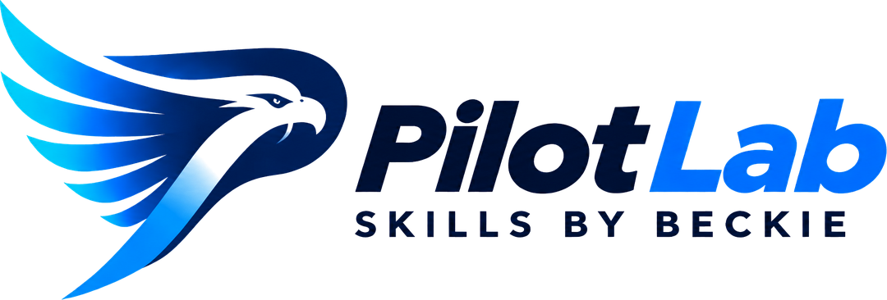
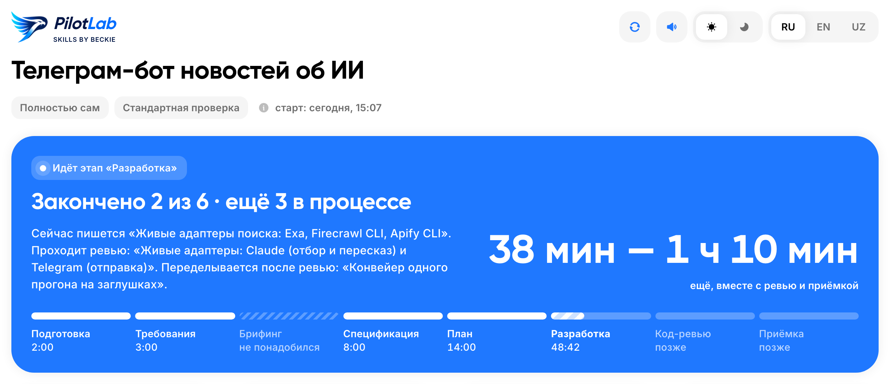
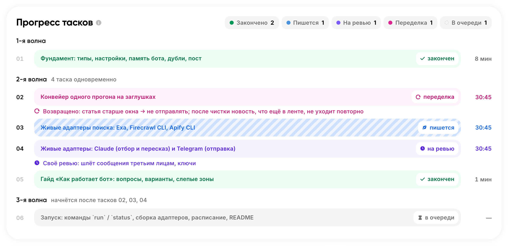
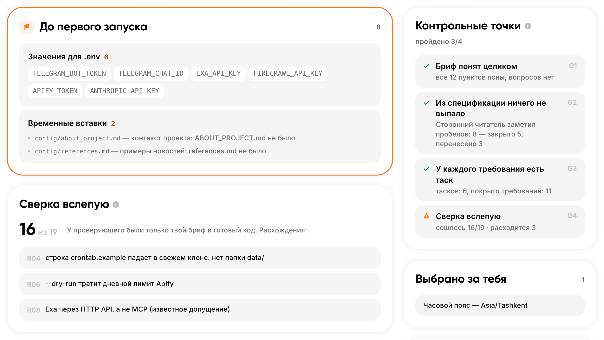
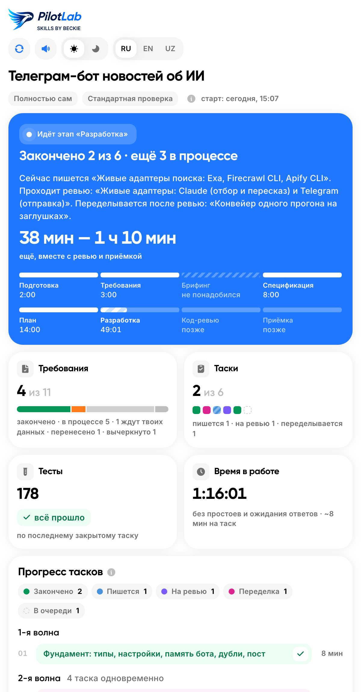
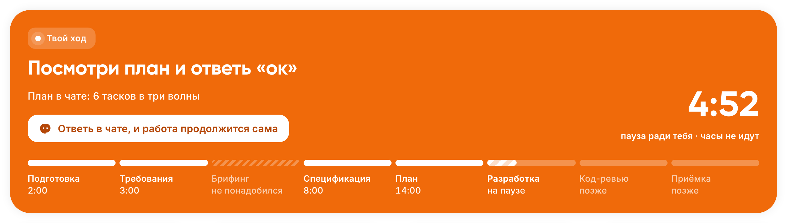
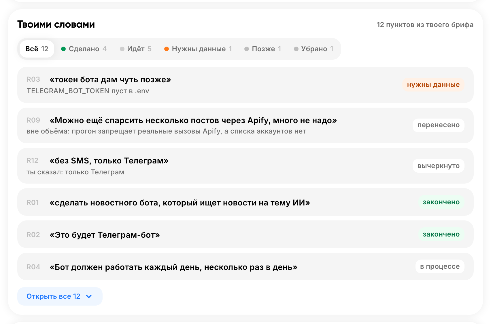

<p align="center">
  <picture>
    <source media="(prefers-color-scheme: dark)" srcset="assets/pilot-lab-logo-dark.png">
    
  </picture>
</p>

<p align="center">
  <a href="https://skills.sh/hiBehruz/PilotLab"></a>
</p>

<p align="center"><b>Скажите, что нужно. Получите готовый проект.</b></p>

<p align="center"><a href="README.md">English</a> · Русский</p>

**Pilot by Beckie** — фреймворк разработки, упакованный в один скилл для AI-агента. Вы даёте идею, он возвращает собранный проект. Вопросы появляются лишь там, где из идеи могут выйти по-настоящему разные продукты. Остальное он делает сам: составляет спецификацию, додумывает несказанное, режет работу на таски и собирает их. Спецификацию читать, объём оценивать и код проверять будет не нужно. Никаких дополнительных установок.

<p align="center">
  <a href="assets/ru/pilot-dashboard.png"></a>
  <a href="assets/ru/pilot-dashboard.png"></a>
  <a href="assets/ru/pilot-dashboard.png"></a>
</p>
<p align="center"><sub><a href="assets/ru/pilot-dashboard.png">Снимок дашборда целиком</a></sub></p>

Пока идёт сборка, за ней можно следить на живом дашборде. Агент открывает его сам в начале сборки. Это один HTML-файл: цвет шапки сразу показывает состояние (синий — работа идёт, оранжевый — ждём вас, зелёный — готово), таймеры идут вживую, страница обновляется сама и работает без интернета.

---

## Содержание

- [Установка](#установка)
- [Как пользоваться](#как-пользоваться)
- [Режимы и глубина](#режимы-и-глубина)
- [Почему результат совпадает с запросом](#почему-результат-совпадает-с-запросом)
- [Дашборд](#дашборд)
- [Память проекта](#память-проекта)
- [Как идёт сборка](#как-идёт-сборка)
- [Подходит ли вам](#подходит-ли-вам)
- [Ключи и секреты](#ключи-и-секреты)
- [Чего он никогда не делает](#чего-он-никогда-не-делает)
- [Обновление и удаление](#обновление-и-удаление)
- [Вопросы и ответы](#вопросы-и-ответы)
- [Что лежит в репозитории](#что-лежит-в-репозитории)
- [Лицензия](#лицензия)

---

## Установка

### Без терминала

Вставьте это своему AI-агенту (Claude Code, Cursor, Codex):

```text
Поставь скилл Pilot by Beckie вот этой командой:
npx skills add hiBehruz/PilotLab --skill pilot-beckie -g -y -a <твой агент: claude-code, cursor или codex>
Если npx нет, дай ссылку на скачивание Node.js (https://nodejs.org) и остановись.
Больше ничего не устанавливай. В конце ответь одной строкой: «Готово, перезапусти сессию».
```

После этого перезапустите сессию: агенты подгружают скиллы только при старте. Этот промпт — для первой установки; новую версию ставьте по разделу [Обновление и удаление](#обновление-и-удаление).

### Из терминала

```bash
npx skills add hiBehruz/PilotLab
```

Дальше нужно выбрать скиллы и агентов, для которых они ставятся, и подтвердить выбор.

<details>
<summary>Установка без диалога</summary>

```bash
npx skills add hiBehruz/PilotLab --skill pilot-beckie -a claude-code -g -y
```

| Опция | Что делает |
|---|---|
| `--skill pilot-beckie` | поставить только этот скилл |
| `-a claude-code` | для какого агента |
| `-g` | глобально: доступен во всех проектах |
| `-y` | без вопросов-подтверждений |

Без `-g` скилл встанет только в текущий проект.

</details>

### Что нужно

- **Node.js** — для `npx`.
- **Python 3**. Учёт сборки и дашборд ведёт небольшой Python-скрипт. Без Python сборка всё равно пройдёт целиком, просто без дашборда.
- **Поддерживаемый агент**: Claude Code, Cursor, Codex или любой из 70+ других из [списка поддерживаемых агентов](https://github.com/vercel-labs/skills#supported-agents).

---

## Как пользоваться

Откройте агента в папке, где будет жить проект, и напишите:

```text
/pilot-beckie телеграм-бот, который записывает клиентов на стрижку в мой барбершоп
```

Pilot запускается **только** этой командой. Сам он не стартует никогда, даже на «просто сделай», потому что создаёт git-репозиторий, пишет код и коммитит.

### Большие идеи — файлом

Если описание длинное, запишите его в любой файл в любом виде (`brief.md`, `idea.txt` — как угодно) и передайте путь:

```text
/pilot-beckie brief.md
/pilot-beckie deep brief.md и всё хранить в SQLite
```

Слова после пути добавляются к задаче. Ваш файл остаётся как есть: Pilot кладёт свою копию в `.pilot-beckie/`, и финальная проверка сверяет результат именно с ней.

### Первый ответ

Прежде всего Pilot сообщает, как он настроен на эту сборку. Примерно так:

```text
Режим: полуавтомат · глубина: обычная. Уточню только неясное
в задаче, а собирать буду сам.
Прогресс: http://localhost:8765/dashboard.html — обновляется сама
раз в 10 секунд, считает рабочее время (пока жду твой ответ — пауза).
Память проекта — AGENTS.md (и CLAUDE.md со ссылкой на него).

Переключить можно в любой момент, просто напиши:
- «делай всё сам» — полностью автоматически;
- «устрой мне интервью» — вопросы до конца, потом соберу без тебя;
- «ручной режим» — то же, плюс ты утверждаешь спецификацию и список тасков;
- «строго по задаче» / «продумай глубже» — меньше или больше проработки сверх сказанного.
```

### Вопросы

Вопросы приходят пронумерованными раундами. У каждого уже есть ответ, который выбрал бы Pilot. Напишите `ок`, чтобы принять все, или поменяйте отдельные по номеру (`2: нет, только карты`).

---

## Режимы и глубина

Две независимые настройки. **Режим** — сколько вас спрашивают. **Глубина** — сколько продумывают за вас.

### Режимы

| Режим | Как включить | О чём спрашивают |
|---|---|---|
| Полный автомат | `full`, «полный автомат», «делай всё сам», «ничего не спрашивай» | Ни о чём. Решения, которые Pilot принял сам, перечислены в итоге. |
| Полуавтомат (по умолчанию) | ничего не писать | Лишь об открытых местах задачи. Обычно один-два раунда, бывает ни одного. |
| Интервью | `interview`, «устрой мне интервью», «погриль меня», «допроси», «спроси меня обо всём» | О каждой развилке идеи и о местах, где идея может не сработать. Потом собирает сам. |
| Ручной | `manual`, «ручной режим», «согласовывай каждый шаг» | Всё как в интервью плюс ваше «ок» на спецификацию и список тасков. |

```text
/pilot-beckie full лендинг для моей пекарни
/pilot-beckie interview приложение для учёта отпусков в команде
/pilot-beckie manual deep brief.md
```

Ключевые слова пишутся без дефисов. Режим можно сменить посреди сборки — он действует со следующего этапа.

В любом режиме, включая `full`, неизменно два правила:

- Перед необратимым действием (публикация, платежи, сообщения людям, удаление данных) Pilot останавливается и спрашивает.
- Финальную сверку с исходным описанием отключить нельзя.

### Глубина

| Глубина | Как включить | Что происходит |
|---|---|---|
| Строго | `strict`, «строго по задаче», «строго по брифу», «ничего не добавляй» | Только написанное. Ошибки и пустые состояния всё равно обрабатываются. |
| Обычная (по умолчанию) | ничего не писать | Закрывает пробелы, которые явно испортили бы результат. Каждое добавление привязано к вашему требованию. |
| Максимум | `deep`, «продумай глубже», «продумай за меня», «проработай глубоко» | Каждое требование проходит полный чек-лист: первый запуск, пустой экран, неверный ввод, сбой, потеря связи, рост, права доступа, последствия. |

Слова режима и глубины пишутся в любом порядке, оба необязательны, глубину тоже можно поменять на ходу.

Правило для любой глубины: всё, что добавил Pilot, привязано к вашему требованию и отдельно перечислено в итоговом отчёте. Функцию, которую не к чему привязать, вырезают.

### Референсы

На брифинге можно назвать сайты, приложения или тексты, на которые должен быть похож результат. Они попадают в `reference.md` и передаются каждому агенту, который делает интерфейс. Референс приходит только от вас — сам Pilot его не выбирает.

---

## Почему результат совпадает с запросом

**Ничего не теряется.** Описание делится на пронумерованные требования, процитированные дословно, у каждого есть статус. Проверки стоят в фиксированных точках:

- после спецификации: у каждого требования есть раздел;
- после плана: каждое требование входит в таск, и каждый таск служит требованию;
- завершает всё слепая приёмка: ещё один агент, которому спецификацию не показывают, сравнивает готовый проект с вашим исходным описанием и больше ни с чем.

Убрать требование можете только вы. Молчание отменой не считается.

**Продумывает то, о чём вы не сказали.** Описание обычно покрывает только «счастливый путь». Pilot додумывает пустые экраны, обрывы связи, двойные отправки, самый первый запуск. Насколько далеко он заходит — задаёт глубина. Мелкие решения он принимает сам, настоящие превращает в вопросы.

---

## Дашборд



`.pilot-beckie/dashboard.html` открывается сам в начале сборки: в боковой панели агента, если она есть (например, в приложении Claude), иначе в браузере. В узкой панели раскладка плотнее. Работает без интернета.

Каждые 10 секунд страница подтягивает свежие данные без перезагрузки — прокрутка и выделение остаются на месте. Стрелка обновления обновляет сразу. Есть переключатели темы (светлая или тёмная; пока не выбрали, следует системе) и языка (RU / EN / UZ).

**Шапка показывает состояние цветом:**

- **Синий — работа идёт.** Фраза о прогрессе и прогноз окончания, уже с учётом код-ревью и приёмки.
- **Оранжевый — ждём вас.** Вопрос брифинга, ваше «ок» на спецификацию в ручном режиме или решение перед необратимым шагом. На вкладке браузера появляется метка ожидания, часы останавливаются.
- **Зелёный — сдано.** Что у вас теперь есть и что нужно подготовить для запуска.
- **Красный — сбой.**

Под шапкой — полоса из восьми этапов: Подготовка, Требования, Брифинг, Спецификация, План, Разработка, Код-ревью, Приёмка.

**Ход разработки.** Каждый таск — строка, окрашенная по состоянию:

| Цвет | Состояние |
|---|---|
| Синий в полоску | пишется |
| Фиолетовый | на ревью |
| Пурпурный | на доработке |
| Зелёный | готово |
| Оранжевый | нужны вы |
| Красный | сбой |
| Серый | в очереди |

У строк на ревью и доработке под ними видна причина. Таски сгруппированы по волнам: видно, что идёт параллельно и чего ждёт каждый таск.

**Ваши слова.** Каждое требование процитировано так, как вы его написали, со статусом: готово, в работе, нужны ваши данные, отложено или снято вами. У отложенного и заглушек указано почему.

<p align="center">
  
  
</p>

| Блок | Что показывает |
|---|---|
| Требования | Сколько закрыто. Таски могут быть на 100%, а ваше описание на 70% — этот блок показывает разницу. |
| Проверки G1–G4 | Описание разобрано целиком · в спецификации ничего не выпало · у всех требований есть таск · слепая приёмка |
| Лента | Последние события простыми словами |
| Нужно от вас | Ключи для `.env`, заглушки, которые надо заменить, решения, принятые за вас |
| Тесты и время | Зелёные тесты; время работы, из которого вычтены простои и ожидание ваших ответов |
| В отчёте | Где слепая приёмка не согласилась, открытые вопросы, замечания ревью с местом в коде |

Маленькие проекты, собранные одним таском, заполняют тот же дашборд. Если сессия оборвалась, напишите просто `/pilot-beckie` — сборка продолжится по своим файлам.

---

## Память проекта

В самом начале Pilot создаёт в корне `AGENTS.md` с названием проекта и командами запуска. По ходу сборки добавляет только то, что действительно выяснилось. Когда сборка закончена, ещё один агент изучает получившийся код (спецификацию он игнорирует) и оставляет краткие указатели на то, где что находится. Большие проекты получают ещё `docs/architecture.md` и `docs/adr/`.

| Факт | Зачем |
|---|---|
| Добавляется однострочный `CLAUDE.md` с `@AGENTS.md` | Claude Code пропускает `AGENTS.md`, если выше по дереву папок есть другой `CLAUDE.md` |
| Ваши `CLAUDE.md` или `AGENTS.md` не меняются никогда | В конце вы получаете предложение дополнения; в полном автомате оно остаётся файлом |
| Память короткая и соразмерна проекту | Это указатели, а не пересказ кода |
| Pilot пишет только между своими маркерами | Всё вне их — ваше |

После каждой сборки `.pilot-beckie/PROGRESS.md` фиксирует, что она оставила: ваши решения, незаконченное, известные баги. Его читают следующая сборка и обычные сессии агента.

Каждый коммит несёт трейлеры `Pilot-Run` и `Requirements`, поэтому `git log --grep="R02"` покажет всё, что сделано по требованию R02.

---

## Как идёт сборка

Порядок — это и есть продукт. Код пишется только на предпоследнем этапе. Всё до него решает, что строить; всё после доказывает, что построено именно это.

| # | Этап | Что происходит |
|---|---|---|
| 1 | Подготовка | Папка и `.gitignore`, открывается дашборд |
| 2 | Требования | Описание превращается в пронумерованные требования, дословно |
| 3 | Брифинг | Раунды вопросов, только о настоящих развилках. Сначала блокеры: платежи, хостинг, доступы |
| 4 | Спецификация | Сценарии поведения продукта |
| 5 | План | Делить ли на таски и как сгруппировать их в волны |
| 6 | Разработка | Один таск = один свежий агент = один коммит. Независимые таски идут параллельно |
| 7 | Код-ревью | Всегда одно ревью всей сборки в конце: соответствие описанию и спецификации, качество, безопасность. Раньше — точечное ревью только для таска-фундамента и тасков, отвечающих за вход, ключи, деньги или удаление данных. Оно идёт параллельно со следующими тасками и никогда их не блокирует |
| 8 | Приёмка | Установка и запуск из чистой копии, сверка с исходным описанием, память проекта, отчёт |

### Как оценивается объём

Объём считают по количеству кода — около 3 000 изменённых строк (с тестами) на одного агента:

| Ожидаемый объём | Тасков |
|---|---|
| до ~3K строк | 1 |
| ~3–6K | 2 |
| ~6–18K | 3–6 |
| ~18–36K | 7–12 |
| больше 12 тасков | две отдельные сборки |

Почему так: каждый агент стартует с нуля, а длинный контекст делает каждый шаг дороже. Около 3K строк — это примерно 300–400K токенов работы одного агента.

### Практики разработки

| Практика | Зачем |
|---|---|
| Отдельный агент на каждый таск | Чистый контекст не тащит за собой старые ошибки |
| Контракты прошлых тасков передаются дальше | Следующие таски опираются на сделанное, а не угадывают |
| Независимые таски идут параллельно | Сборка короче |
| Один коммит на таск | К любому таску можно откатиться |
| Таски с общими файлами идут по очереди | Нет конфликтующих правок |
| Полная проверка после каждого таска: тесты, типы, линтер | Поломку ловят там, где её внесли |
| Дешёвая модель на рутину, сильная на фундамент и рискованное | Деньги идут туда, где ошибка дорога |
| Ревью всей сборки в конце плюс узкое точечное ревью максимум с одной перепроверкой | Качество без бесконечных кругов ревью |
| Исправляет тот же агент, что писал код | Он уже знает этот код |
| Оркестратор не пишет код | Его контекст живёт всю сборку и должен оставаться чистым |
| Упавший таск: повтор, потом другой подход, потом остановка с объяснением | Никаких тихих циклов |
| Если план разошёлся с реальностью, его правят вслух | Вы видите, почему он изменился |

---

## Подходит ли вам

| Подходит | Лучше иначе |
|---|---|
| Вы описываете и ждёте готовый результат | Писать код вместе построчно — работайте с агентом напрямую |
| Вы не программист или не хотите программировать | Правка одного файла — просто попросите агента |
| «Сделай под ключ» | Идея без понятной конечной цели — сначала определитесь с целью |
| Хотите утверждать спецификацию и таски, не управляя процессом, — `manual` | |

---

## Ключи и секреты

- Pilot никогда не просит ключи, токены или пароли. Он спрашивает только, каким сервисом вы пользуетесь и есть ли у вас аккаунт.
- Код обращается к именам переменных окружения, например `STRIPE_SECRET_KEY`; значения в `.env` вписываете вы сами.
- `.env` сразу попадает в `.gitignore`.
- В отчёте перечислены недостающие переменные — только имена, без значений.
- Если вы всё же вставили ключ в чат, в файл он не попадёт. Фильтр распознаёт ключи Stripe, GitHub, AWS, Google и Slack, токены Telegram, JWT и строки подключения и пишет вместо них `[REDACTED:<NAME>]`, а вам приходит предупреждение отозвать ключ.

---

## Чего он никогда не делает

- Пишет код до спецификации.
- Вычёркивает ваши требования.
- Сочиняет факты о вас: любая неизвестная ему цена, текст или адрес остаётся заметной заглушкой.
- Просит вас проверить таски или код.
- Держит два таска в памяти одного агента.
- Оставляет платежи, доступы или хостинг на конец.
- Запрашивает или хранит секреты.
- Устанавливает или скачивает что-то без вашего ведома.

---

## Обновление и удаление

Обновлять только так:

```bash
npx skills update pilot-beckie -g
```

Если скилл установлен в проект, запускайте внутри проекта без `-g`. Не переустанавливайте через `npx skills add`.

Или вставьте агенту:

```text
Обнови скилл Pilot by Beckie: выполни `npx skills update pilot-beckie -g`.
Когда обновлять якобы нечего, но версия явно устаревшая, выполни
npx skills remove pilot-beckie -g -y && npx skills add hiBehruz/PilotLab --skill pilot-beckie -g -y -a <твой агент>
Потом напомни мне перезапустить сессию.
```

Другие команды:

```bash
npx skills list                   # что установлено
npx skills remove pilot-beckie -g # удалить
```

Почему `update` иногда ничего не делает: он сравнивает версии источника, а не файлы на вашем диске. Если локальную копию правили или она повреждена, пара «удалить и добавить» выше ставит её начисто. После любого обновления перезапустите сессию.

**Проверка версии.** В начале сборки скилл сравнивает свою версию (`metadata.version` в `skills/pilot-beckie/SKILL.md`) с репозиторием. Если есть новее, вы увидите одну строку с командой обновления. Посреди сборки он не обновляется никогда. Это один запрос к GitHub за сборку, никаких данных о вас не отправляется, без сети проверка просто молчит. Отключить: `PILOT_BECKIE_NO_UPDATE_CHECK=1`. Что изменилось: [CHANGELOG.md](CHANGELOG.md).

---

## Вопросы и ответы

**Он запускается сам?**
Нет. Только по `/pilot-beckie`.

**Сессия оборвалась. Что делать?**
Напишите `/pilot-beckie` без ничего. Сборка продолжится по своим файлам.

**Дашборд пишет, что связь потеряна.**
Компьютер уснул или остановился маленький локальный сервер. Попросите агента поднять дашборд снова. Открытая вкладка восстановится сама, без перезагрузки.

**Нужен ли интернет для дашборда?**
Нет.

**Я вставил ключ в чат.**
Он заменён на `[REDACTED:…]` раньше, чем попал в какой-либо файл. Но всё равно отзовите его и выпустите новый.

**`update` говорит, что всё актуально, а поведение старое.**
Удалите и добавьте заново, как в разделе [Обновление и удаление](#обновление-и-удаление).

**Можно сменить режим или глубину посреди сборки?**
Да. Просто скажите — подействует со следующего этапа.

**Подходит ли для небольших правок в существующем проекте?**
Да. Всё, что укладывается примерно в 3K изменённых строк, идёт одним таском. Правку одного файла проще попросить у агента напрямую.

**Какие агенты поддерживаются?**
Claude Code, Cursor, Codex и ещё 70+; см. [список поддерживаемых агентов](https://github.com/vercel-labs/skills#supported-agents).

---

## Что лежит в репозитории

```text
skills/pilot-beckie/
├── SKILL.md                    оркестратор: порядок этапов, проверки, правила, которые важнее всего
├── phases/                     по файлу на этап, читается только когда этап начался
│   ├── 0-modes.md              режим и глубина: разбор и смысл
│   ├── 0-preflight.md          новая сборка, продолжение или новая функция; настройка git
│   ├── 0-resume.md             как вернуться к оборванной сборке
│   ├── 0-instruments.md        скрипт учёта и дашборд
│   ├── 0-memory.md             выбор файла памяти проекта
│   ├── 1-manifest.md           фильтр секретов, дословные требования, проверки G1–G4
│   ├── 2-briefing.md           раунды вопросов
│   ├── 2-adversarial.md        стресс-тест: где идея может не сработать
│   ├── 3-spec.md               спецификация и границы модулей
│   ├── 4-plan.md               оценка объёма, таски, волны
│   ├── 5-subagents.md          запуск тасков в свежих агентах
│   ├── 5-repair.md             доработки, сбои, правка плана
│   ├── 6-review.md             ревью: точечное и по всей сборке
│   ├── 8-final.md              сдача: слепая приёмка и отчёт
│   ├── 9-memory.md             память проекта
│   ├── rationalizations.md     проверка на отговорки и срезанные углы
│   └── dashboard-template.html страница дашборда
├── prompts/
│   ├── executor.md             задание агенту, который делает таск
│   └── review.md               задание агенту-ревьюеру
└── tools/
    └── ap.py                   учёт сборки: состояние, дашборд, локальный сервер; одна команда на событие
tests/test_ap.py                тесты для ap.py
tools/measure-run.py            измеряет реальную сборку по логам Claude Code
docs/pilot-beckie/design.md     обоснование решений, для мейнтейнеров
assets/                         логотип и скриншоты (assets/ru/ — русский интерфейс)
skills-lock.json                метаданные для установщика npx skills
LICENSE                         MIT
```

Файлы этапов читаются по одному, когда этап начинается. Файлы для редких случаев — только когда такой случай возник. Обоснование правил живёт в `docs/`, а не в инструкциях агента, чтобы агент не платил за него на каждом шаге. Всё — обычный Markdown; читать стоит с [SKILL.md](skills/pilot-beckie/SKILL.md), дальше по ссылкам.

---

## Лицензия

[MIT](LICENSE) © Behruz Zaripov

Разрешены использование, изменение и распространение, коммерческое тоже, при условии что уведомление об авторских правах и лицензии остаётся при коде.
